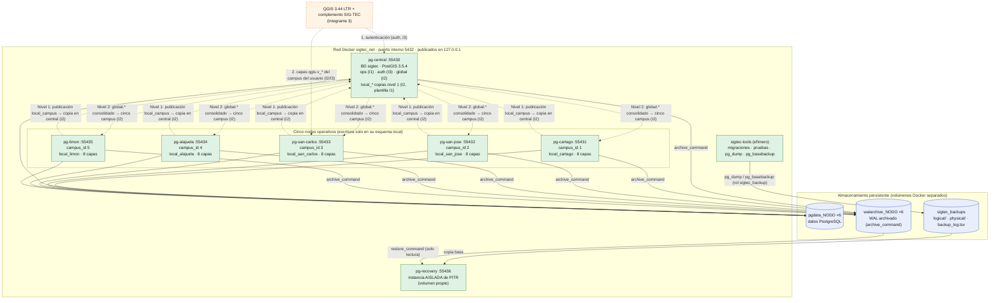

# Arquitectura SIG-TEC

## 1. Topología

Líneas continuas = **implementado y probado** por el Integrante 1.
Líneas punteadas = **rutas reservadas** para los Integrantes 2 (replicación) y 3 (QGIS/autenticación).

**Dónde se escribe:** cada objeto geográfico se crea, modifica y elimina únicamente en las
tablas originales `local_<campus>.*` del nodo de su campus. **Cómo circulan las copias
(Integrante 2):** nivel 1, cada campus publica su esquema local hacia un esquema con el
mismo nombre en el central; nivel 2, el central consolida en `global.*` y lo distribuye a
los cinco campus. **A qué nodo se conecta QGIS (Integrante 3):** primero al central para
autenticarse; luego al nodo del campus del usuario, donde lee las vistas `qgis.v_*`
(locales + copias de los otros cuatro).

## 2. Nodos, red y puertos

| Servicio | Host interno | Puerto host | `campus_id` | Volúmenes | `cluster_name` |
|---|---|---|---|---|---|
| `pg-central` | pg-central | 127.0.0.1:55430 | — | `sigtec_pgdata_central`, `sigtec_walarchive_central` | pg-central |
| `pg-cartago` | pg-cartago | 127.0.0.1:55431 | 1 | `sigtec_pgdata_cartago`, `sigtec_walarchive_cartago` | pg-cartago |
| `pg-san-jose` | pg-san-jose | 127.0.0.1:55432 | 2 | `sigtec_pgdata_san_jose`, `sigtec_walarchive_san_jose` | pg-san-jose |
| `pg-san-carlos` | pg-san-carlos | 127.0.0.1:55433 | 3 | `sigtec_pgdata_san_carlos`, `sigtec_walarchive_san_carlos` | pg-san-carlos |
| `pg-alajuela` | pg-alajuela | 127.0.0.1:55434 | 4 | `sigtec_pgdata_alajuela`, `sigtec_walarchive_alajuela` | pg-alajuela |
| `pg-limon` | pg-limon | 127.0.0.1:55435 | 5 | `sigtec_pgdata_limon`, `sigtec_walarchive_limon` | pg-limon |
| `pg-recovery` (perfil `recovery`) | pg-recovery | 127.0.0.1:55436 | del nodo restaurado | `sigtec_pgdata_recovery`, `sigtec_walarchive_recovery` + lectura de respaldos y archivos WAL | pg-recovery |
| `sigtec-tools` (perfil `tools`) | — | — | — | `sigtec_backups`, archivos WAL (solo lectura), `./scripts`, `./sql`, `./tests` (solo lectura) | — |

* Red bridge `sigtec_net`; entre contenedores se usa el host interno y el puerto 5432.
* Una base `sigtec` por nodo; PostGIS creado en el primer arranque y garantizado por migración.
* `restart: unless-stopped`: los nodos vuelven solos tras reiniciar Docker; un `kill`/`stop` manual se respeta.
* Healthcheck: `pg_isready` por TCP cada 5 s (healthy solo cuando terminó la inicialización).

## 3. Orden de arranque e inicialización

1. `pg-central` inicia primero; los cinco campus declaran `depends_on: pg-central (service_healthy)`
   porque autenticación (I3) y suscripciones (I2) dependen de él. Los campus no dependen entre sí.
2. **Primer arranque (volumen vacío)** — `docker-entrypoint.sh` oficial ejecuta `initdb`
   (`--data-checksums`, UTF-8, `C.UTF-8`), crea la base `sigtec` y corre
   `docker/postgis/initdb/10-sigtec-init.sh` (`CREATE EXTENSION postgis`). Esto **solo** ocurre
   con volumen vacío.
3. **Migraciones (siempre, idempotentes)** — `scripts/db/migrate.sh`:
   `sql/bootstrap/` → `sql/migrations/common/` (seis nodos) → `sql/migrations/campus/` (cinco campus),
   cada migración en una transacción y registrada con su SHA-256 en `ops.schema_migrations`;
   después sincroniza `ops.node_info` y el rol `sigtec_backup`.
4. **Datos de prueba** — `scripts/db/seed.sh`, controlado por `ops.seed_runs` (no se recarga).

Distinción importante: lo que está en `docker/postgis/initdb/` corre una sola vez por
volumen; **todo cambio de estructura** se agrega como una migración nueva en `sql/migrations/`
(nunca editando una ya aplicada: el ejecutor avisa si el SHA-256 cambió).

## 4. Configuración PostgreSQL relevante

Archivo único `docker/postgis/conf/postgresql.conf` (incluido en la imagen) + `pg_hba.conf`.

| Parámetro | Valor | Motivo |
|---|---|---|
| `wal_level` | `logical` | Replicación lógica del Integrante 2 (y suficiente para PITR) |
| `max_wal_senders` / `max_replication_slots` | 16 / 16 | Hasta 5 suscripciones nivel 1 + 5 nivel 2 + respaldos |
| `max_logical_replication_workers` / `max_worker_processes` | 8 / 16 | Trabajadores de aplicación y sincronización |
| `max_slot_wal_keep_size` | 4GB | Un slot abandonado no llena el disco |
| `track_commit_timestamp` | on | Marca de tiempo por transacción (auditoría, conflictos, evidencias PITR) |
| `archive_mode` / `archive_command` | on / `sigtec-archive-wal "%p" "%f"` | Archivado continuo a un volumen distinto del de datos |
| `archive_timeout` | 300 s | Acota la pérdida máxima en nodos con poca actividad |
| `password_encryption` | scram-sha-256 | Contraseñas SCRAM |
| `ssl` | on (TLS ≥ 1.2) | Certificado autofirmado generado al iniciar el contenedor |
| `timezone` | America/Costa_Rica | Registros y fechas locales (los objetivos PITR se expresan con zona) |
| `shared_buffers` | 128MB | Seis instancias en una sola máquina de desarrollo |

`pg_hba.conf`: socket local `peer` para `postgres`; `replication` solo para `sigtec_backup`
(el resto se rechaza); toda conexión TCP exige SCRAM. Las suscripciones lógicas usan la
regla `host all all` (se conectan a una base concreta, no a `replication`).

## 5. Seguridad básica

* Puertos publicados solo en `127.0.0.1` por defecto.
* Contraseñas generadas aleatoriamente en `.env` (permisos 600, ignorado por git); nada en SQL ni documentación.
* Rol de respaldo de mínimo privilegio `sigtec_backup` (`REPLICATION` + `pg_read_all_data`, sin superusuario).
* Esquemas `local_*` y `ops` con `REVOKE ALL ... FROM PUBLIC`; los permisos de las cuentas QGIS los definen I2/I3.
* La función de asignación de ids es `SECURITY DEFINER` con `search_path` fijo: las cuentas de edición no necesitan permisos sobre la secuencia.

## 6. Decisiones técnicas y contradicciones encontradas

| Tema | Situación | Decisión |
|---|---|---|
| PostGIS 3.5.4 | `postgis/postgis:17-3.5` solo existe para amd64 y PGDG no publica 3.5.4 (pasó de 3.5.3 a 3.6/3.7). | Imagen propia: `postgres:17.12-trixie` fijada por digest + PostGIS 3.5.4 compilado desde el tarball oficial de OSGeo con SHA-256 verificado. Versiones exactas del contrato. |
| GEOS/PROJ | Vienen de los paquetes de compilación disponibles (PGDG trixie): GEOS 3.15.0, PROJ 9.9.0. | Registradas en `evidence/versions.txt`; una recompilación futura podría traer versiones menores distintas (ver DEPENDENCIES). |
| Identificadores del enunciado (101, 102, 201, 301) | Son ilustrativos; el contrato fija `campus_id × 10⁹ + consecutivo`. | Se aplica el contrato (`1000000001`, `3000000001`, …). |
| `id` con DEFAULT | Un DEFAULT `nextval()` haría que QGIS consuma consecutivos al abrir formularios y obligaría a dar permiso sobre la secuencia. | Sin DEFAULT: un disparador `BEFORE INSERT` asigna el id si llega NULL; un id explícito se rechaza salvo modo de mantenimiento (`sigtec.permitir_id_explicito`), que además valida rango y unicidad entre capas. |
| `disponibilidad` de parqueos | Ambiguo (estado o cantidad). | Entero: espacios disponibles, `0 ≤ disponibilidad ≤ capacidad`. |
| Esquema operativo | Tablas de control dentro de `local_*` contaminarían `FOR TABLES IN SCHEMA`. | Esquema separado `ops` (no se replica). Cada `local_*` contiene solo las ocho capas. |
| Esquemas `auth`, `global`, `qgis` | Pertenecen a I2/I3. | No se crean (evita conflictos de propiedad y errores en sus `CREATE SCHEMA`). |
| Respaldos en carpeta OneDrive | El proyecto vive en una carpeta sincronizada; archivos "solo en la nube" romperían una restauración. | Datos, WAL archivado y respaldos en volúmenes Docker; la carpeta solo tiene código y evidencias de texto. |
| Fecha de entrega | El enunciado dice "30 de noviembre 2026" en la portada y "30 de junio 2026" en Aspectos Administrativos. | No afecta la implementación; conviene confirmarla con el docente. |

## 7. Limitaciones del entorno de desarrollo

* Seis nodos, el archivo WAL y los respaldos están en la **misma máquina/VM de Docker**
  (volúmenes separados, mismo disco). En producción el archivo WAL y los respaldos deben ir a
  otro equipo o almacenamiento remoto.
* TLS con certificado autofirmado regenerado al recrear el contenedor: sirve para cifrar
  (`sslmode=require`/`prefer`), no para `verify-full`.
* No hay programación automática de respaldos (cron); se ejecutan con `make backup`.
* Probado en macOS 27 (Apple Silicon, Docker Desktop 29.2). Linux/Windows: scripts preparados, no ejecutados aquí.
