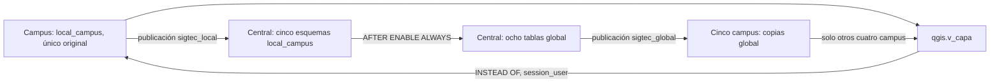

# Integrante 2: replicación, vistas y transacciones

Este desarrollo corresponde a los cinco puntos del bloque «Integrante 2» del PDF entregado (páginas 2 y 3), y al contrato de sus páginas 4 a 6. Se apoya en la implementación existente del integrante 1. El escenario elegido para la transacción distribuida es registrar una operación autorizada en el campus y el central. El alcance académico de ese escenario debe acordarse con el docente, como indica el documento.

## Archivos y arquitectura

- `scripts/distributed/manage.py`: instalación, comparación de filas, coordinador 2PC, distribución de estilos y reincorporación.
- `sql/distributed/functions.sql`: disparadores, mapa privado de identidad y campus, tablas de coordinación y máximo identificador observado.
- `tests/distributed/integration.py`: CRUD de las ocho capas en los cinco campus, rechazos de edición ajena y propagación en ambos niveles.
- `tests/distributed/test_coordinator.py`: pruebas locales de decisiones durables y recuperación del coordinador.



Cada destino conserva esquema y nombre de la tabla publicada. Las publicaciones incluyen exclusivamente las ocho capas, con INSERT, UPDATE y DELETE. Cada tabla tiene PK `id` como identidad de réplica. No se replican `ops`, secuencias, roles ni DDL. Los originales nunca reciben replicación desde central. No usar TRUNCATE para borrar originales: no forma parte de las publicaciones.

El central usa `ENABLE ALWAYS` para que la consolidación se ejecute también durante el apply lógico. Tras la sincronización inicial se reconcilian las tablas globales bajo bloqueo de las copias de origen. Las suscripciones admiten `origin=any`, necesario para redistribuir los cambios recibidos. Cada suscriptor tiene una ranura distinta. Las vistas muestran inmediatamente los originales locales y excluyen la copia de su propio campus para evitar duplicados y retrasos visibles en la edición local.

## Instalación en Windows

Requisitos adicionales a I1: Python 3.10 o posterior en el host. No necesita instalar paquetes con pip. Ejecutar desde la raíz del proyecto con Docker Desktop activo.

```powershell
# Configuración de I1 y datos sintéticos, si aún no existen:
& "C:/Program Files/Git/bin/bash.exe" scripts/setup.sh
# Alternativa sin Git Bash: powershell -ExecutionPolicy Bypass -File scripts/setup.ps1

# Si ya había una imagen anterior a este cambio, reconstruir y recrear.
# Recrear contenedores conserva los volúmenes y datos.
docker compose build pg-central
docker compose up -d --force-recreate pg-central pg-cartago pg-san-jose pg-san-carlos pg-alajuela pg-limon

python scripts/distributed/manage.py setup
python scripts/distributed/manage.py verify
```

La nueva imagen habilita `max_prepared_transactions=16`. Reiniciar una imagen vieja no incorpora el archivo modificado: debe reconstruirse. `setup` comprueba ese requisito antes de instalar.

`setup` genera `SIGTEC_REPL_PASSWORD` en `.env` si falta y utiliza las contraseñas QGIS ya generadas por I1. El secreto de replicación admite letras ASCII y dígitos para construir el conninfo sin escapes ambiguos. No imprimir `.env` ni subirlo al repositorio. La conexión lógica usa TLS y un rol `sigtec_repl` con REPLICATION y SELECT sobre las tablas publicadas.

La instalación puede repetirse antes de una reincorporación; las suscripciones y tablas existentes se conservan. La reconciliación global produce tráfico de borrado/inserción: repetir con ediciones pausadas. Si falla a mitad, corregir la causa y repetir; no eliminar ranuras ni datos para forzar el arranque. Después de una reincorporación, el instalador se niega a sobrescribir las rutas recuperadas.

## Contrato para el integrante 3

En cada campus se crean las ocho vistas `qgis.v_edificios`, `qgis.v_carreteras`, `qgis.v_aceras`, `qgis.v_parqueos`, `qgis.v_zonas_verdes`, `qgis.v_puntos_interes`, `qgis.v_iluminacion`, `qgis.v_accesibilidad`. Conservan todas las columnas del diccionario original, `id bigint` como clave, `campus_id smallint`, `geom` con su tipo original y SRID 5367. Configurar explícitamente esos valores en la URI de QGIS.

Se crea una cuenta de edición en su nodo: `qgis_cartago`, `qgis_san_jose`, `qgis_san_carlos`, `qgis_alajuela` o `qgis_limon`. Contraseña: variable `SIGTEC_QGIS_<CAMPUS>_PASSWORD` de `.env`. Puertos 55431 a 55435 según el contrato existente. El instalador de PowerShell de I1 selecciona el primer `bash` del PATH; si corresponde al lanzador WSL sin una distribución instalada, usar explícitamente Git Bash como en el ejemplo.

El alta de esas cuentas en el central y `auth.usuario_campus` corresponde a I3; este desarrollo prepara la cuenta de datos, no el inicio de sesión del complemento.

La asociación autorizada se guarda en `ops.editor_campus`, modificable solamente por el administrador. Los disparadores consultan `session_user`, conservado dentro de SECURITY DEFINER; no confían en GUCs enviados por el cliente, `campus_id` de un formulario o `current_user` dentro del disparador. Las cuentas reciben DML solamente en las vistas, sin escritura sobre originales, copias ni secuencias. Mantenerlas sin membresías administrativas o del rol de mantenimiento.

Para INSERT, omitir `id` o enviar NULL y omitir `campus_id` o enviar el propio. PostgreSQL devuelve la fila completa con `RETURNING`, incluido el id asignado. UPDATE no puede cambiar id ni campus. UPDATE y DELETE validan el propietario anterior y bloquean la fila local antes de modificarla. SQLSTATE `42501`: identidad o edición no permitida; `23514`: id/campus inválido o cambio de dueño.

## Pruebas y evidencia

```powershell
python -m unittest discover -s tests/distributed -p "test_*.py" -v
New-Item -ItemType Directory -Force evidence/distributed | Out-Null
python tests/distributed/integration.py 2>&1 | Tee-Object evidence/distributed/integration.log
python scripts/distributed/manage.py verify 2>&1 | Tee-Object evidence/distributed/verify.log
```

La integración crea objetos sintéticos temporales en todas las capas y campus y los elimina al terminar cada caso. Consume ids, que no deben reutilizarse. No ejecutarla sobre una presentación con ediciones simultáneas. Verifica cada fila en el central y en las cinco copias y vistas. Comprueba rechazo de INSERT/UPDATE/DELETE ajenos, cambio de id/campus y escritura directa. `verify` compara todas las columnas y las geometrías, ordenadas por id, en ambas rutas; no se limita a contar filas. Los tiempos de espera son finitos.

Los registros antiguos bajo `audit`, `remediation` y `evidence` pertenecen al trabajo de I1 y no prueban estos componentes nuevos. El estado de validación de esta entrega se registra en `docs/INTEGRANTE_2_VALIDACION.md`.

## Transacción distribuida y recuperación del coordinador

```powershell
python scripts/distributed/manage.py transaction --node san_carlos
python scripts/distributed/manage.py transaction --node san_carlos --fail
python scripts/distributed/manage.py transaction --node san_carlos --crash-after-decision
python scripts/distributed/manage.py resolve
```

Cada operación inserta el mismo identificador en `ops.operaciones_distribuidas` de San Carlos y central. Caso normal: confirmar ambos. `--fail`: falla antes de preparar el central y revierte el campus. `--crash-after-decision`: deja ambos preparados tras guardar COMMIT, para demostrar su resolución posterior. Esta es una operación administrativa del coordinador; las cuentas QGIS no tienen acceso a esta tabla.

El diario local `.distributed-state/sigtec_*.json` registra los participantes y ABORT antes del primer PREPARE. Después de preparar ambos se persiste COMMIT mediante escritura, fsync y reemplazo del archivo. `resolve` consulta las transacciones pendientes y aplica la decisión, pudiendo repetirse si un participante estuvo desconectado. Una interrupción anterior a COMMIT utiliza ABORT. Un bloqueo de proceso evita que dos comandos de administración de esta PC decidan simultáneamente. Conservar el diario y trabajar desde una sola copia del coordinador; perder el diario después de decidir COMMIT hace imposible decidir automáticamente con seguridad. Es una demostración académica con coordinador único, no un servicio de alta disponibilidad.

No dejar transacciones preparadas abiertas: conservan bloqueos. Si un nodo no responde, `resolve` termina con error y conserva la decisión para reintentar. Consultar `pg_prepared_xacts` y `ops.operaciones_distribuidas` en ambos participantes durante la grabación.

## Reincorporación tras PITR

Política explícita: el contenido recuperado al instante elegido se considera la verdad de ese campus. Se retiran del central y de las copias los objetos posteriores al instante recuperado. Los demás campus conservan sus originales. Antes de cambiar las copias, el script guarda sus filas en `.distributed-state/before_rejoin_*.json` para revisión. Esta política debe explicarse en la demostración: un PITR puede descartar cambios posteriores a su objetivo.

```powershell
# Primero I1 entrega una instancia PITR real y validada. Demostracion con Git Bash:
& "C:/Program Files/Git/bin/bash.exe" scripts/recovery/pitr_demo.sh san_carlos --keep-failed
# Si se recibe una instancia ya restaurada, sin make:
docker compose --profile tools run --rm -T sigtec-tools -c "bash scripts/db/migrate.sh recovery"
docker compose --profile tools run --rm -T sigtec-tools -c "bash scripts/db/verify.sh recovery"

# Pausar ediciones y detener el dueño anterior (se conservan datos y volúmenes):
docker compose stop pg-san-carlos
python scripts/distributed/manage.py rejoin --node san_carlos
python scripts/distributed/manage.py verify
```

El script exige que el nodo anterior esté detenido, que `pg-recovery` corresponda al campus y que su registro de identificadores sea válido. Bloquea temporalmente el login QGIS de recovery y cierra sus sesiones, separa las suscripciones heredadas sin eliminar ranuras ajenas, ajusta la secuencia al máximo observado en central y copia de nuevo el origen recuperado. Los máximos observados incluyen objetos eliminados desde que la consolidación está activa. Cambios que nunca alcanzaron el central antes del fallo están sujetos al RPO del respaldo y de la replicación asíncrona.

Se recrean ambas rutas con ranuras nuevas, se comparan filas y se habilita el login al finalizar. QGIS debe conectarse al puerto **55436** del reemplazo; actualizar la configuración de I3. El mapeo local `routes.json` permite que las verificaciones posteriores usen el reemplazo. Mantener detenido el dueño viejo para evitar dos escritores.

Ejecutar esta maniobra en mantenimiento, sin otros administradores escribiendo. Si falla, el login puede quedar bloqueado y las rutas parcialmente reconstruidas: inspeccionar diario, suscripciones y evidencia antes de continuar; no repetir a ciegas. Las ranuras antiguas desacopladas se conservan para diagnóstico y deben inventariarse y retirarse manualmente cuando se descarte volver al nodo anterior. La reincorporación es una operación de una sola ejecución, no un bucle de failover automático. Para demostrar nuevas escrituras tras recuperar, ejecutar `python tests/distributed/integration.py --node san_carlos` con el mapeo ya guardado. La prueba restringe las ediciones a ese campus y sigue comprobando su propagación en todos los destinos.

## Estilos institucionales

Después de que I3 cree `public.layer_styles` en central con QGIS:

```powershell
python scripts/distributed/manage.py styles
```

Se exporta su DDL real, se crean destinos, se usa REPLICA IDENTITY FULL y una publicación/suscripción separada por campus, con SELECT para su cuenta QGIS. Crear o modificar estilos únicamente en central. I3 debe guardar estilos para las vistas `qgis.v_*`, base `sigtec`, geometría `geom`, con el estilo por defecto apropiado. El esquema de estilos aún inexistente no se inventa ni impide instalar las capas. Después de un PITR, volver a coordinar la distribución de estilos con I3 y verificar el dibujo desde QGIS.

## Guion del segmento de video

1. Mostrar cinco originales y los esquemas destino del central, publicaciones y suscripciones.
2. Crear un punto propio desde QGIS, mostrar su id en central y en otro campus; modificarlo y eliminarlo.
3. Mostrar el rechazo de las tres ediciones ajenas y la ausencia de cambios en su dueño.
4. Ejecutar confirmación, reversión e interrupción/resolución del coordinador.
5. Recibir PITR de I1, reincorporar y mostrar `verify` sin diferencias; I3 vuelve a iniciar sesión por 55436 y edita.

## Fuentes técnicas

- PostgreSQL 17, arquitectura y comportamiento del apply: https://www.postgresql.org/docs/17/logical-replication-architecture.html
- PostgreSQL 17, restricciones (DDL y secuencias no replicados): https://www.postgresql.org/docs/17/logical-replication-restrictions.html
- PostgreSQL 17, publicación y suscripción: https://www.postgresql.org/docs/17/logical-replication.html
- PostgreSQL 17, PREPARE TRANSACTION y coordinador externo: https://www.postgresql.org/docs/17/sql-prepare-transaction.html
- Documento entregado por el usuario: BDII_project3.pdf, páginas 2 a 6.
